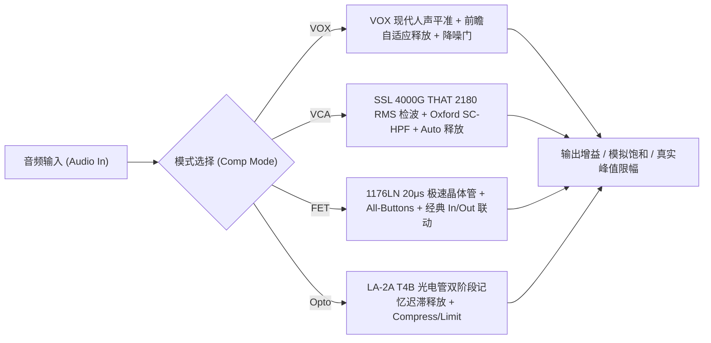

# SanMu Comp (三木压缩器) 官方技术白皮书与用户手册

---

## 📖 目录
1. [产品概述与设计哲学](#1-产品概述与设计哲学)
2. [四大经典独立物理建模引擎](#2-四大经典独立物理建模引擎)
   * [2.1 VOX 模式（现代人声动态平准）](#21-vox-模式现代人声动态平准)
   * [2.2 VCA 模式（SSL 4000 G Bus 经典总线胶水）](#22-vca-模式ssl-4000-g-bus-经典总线胶水)
   * [2.3 FET 模式（Urei 1176LN 极速晶体管抓击）](#23-fet-模式urei-1176ln-极速晶体管抓击)
   * [2.4 Opto 模式（Teletronix LA-2A T4B 光电管温润）](#24-opto-模式teletronix-la-2a-t4b-光电管温润)
3. [SanMu Copilot (AI 智能混音副驾驶)](#3-sanmu-copilot-ai-智能混音副驾驶)
   * [3.1 零锁实时声学特征提取器（Acoustic Feature Extractor）](#31-零锁实时声学特征提取器acoustic-feature-extractor)
   * [3.2 双轨智能中枢：本地物理方程推荐 vs 云端大模型微调](#32-双轨智能中枢本地物理方程推荐-vs-云端大模型微调)
   * [3.3 A/B 槽位无缝盲听对比系统](#33-ab-槽位无缝盲听对比系统)
4. [各音轨乐器实战调校速查指南](#4-各音轨乐器实战调校速查指南)
5. [技术规格与兼容性](#5-技术规格与兼容性)

---

## 1. 产品概述与设计哲学

**SanMu Comp** 是 SanMun Audio 倾力打造的旗舰级四合一模拟硬件电路建模与 AI 辅助混音压缩器插件。

* **极致纯粹**：100% 还原四大经典压缩器（VOX / VCA / FET / Opto）原生物理电路动态响应、非线性失真与时间常数曲线。各模式完全独立隔离，保留原汁原味的经典手感与专属出厂预设。
* **次世代 AI 赋能**：内置 **SanMu Copilot 混音副驾驶**，支持**零门槛本地声学物理方程推荐**（无需网络与 API Key，毫秒级即刻根据音频特征计算出黄金 A/B 双方案）与**云端大语言模型深度对话微调**（支持 Gemini / DeepSeek 多轮自然语言追问）。

---

## 2. 四大经典独立物理建模引擎

### 2.1 VOX 模式（现代人声动态平准）
* **硬件对标**：Waves Renaissance Vox (RVox) 现代人声平准传奇。
* **DSP 核心**：
  * **前置双推子平准**：`Comp` 单推子控制动态下压与自动前置平准；
  * **前瞻自适应双阶释放**：256 采样点（5.33ms）零相位前瞻，前 65% 快速释放（约 35ms）消除齿音粗糙感，后 35% 缓慢释放（约 200ms）保持人声自然饱满；
  * **下扩展降噪门（Gate）**：在歌词停顿间隙智能衰减呼吸底噪与喷麦窜音；
  * **0dBFS 天花板安全防护**：`Gain` 推子直接决定最终输出真实峰值，防止后续母带过载。

### 2.2 VCA 模式（SSL 4000 G Bus 经典总线胶水）
* **硬件对标**：Solid State Logic (SSL) 4000 G-Master Stereo Bus Compressor。
* **DSP 核心**：
  * **THAT 2180 True RMS 检波**：忠实复刻英国经典调音台总线 VCA 芯片的对数均方根响应；
  * **Oxford 侧链高通滤波（SC-HPF）**：$20\text{Hz} \sim 500\text{Hz}$ 连续可调，避开底鼓与贝斯能量引起的误触抽吸；
  * **Auto 双阶段自适应释放**：针对瞬态采用极速释放（$100\text{ms}$），针对大动态持续乐句平缓衰减（$1.2\text{s}$），赋予混音强烈的“粘合感（Glue）”与宏大声场。

### 2.3 FET 模式（Urei 1176LN 极速晶体管抓击）
* **硬件对标**：Urei 1176LN Peak Limiter (Blackface/Rev D)。
* **DSP 核心**：
  * **$20\ \mu\text{s}$ 极速晶体管抓取**：世界上最快且最富攻击性的晶体管反馈式检波；
  * **经典反向 In/Out 联动控制**：固定内部参考电平（$+4\text{dBu}$），由 `Input` 驱动压缩深度，`Output` 补足电平；
  * **全按钮极限模式（All-Buttons Mode）**：一键激活 $20:1$ 极限爆炸压缩曲线、偏置电压偏移与极富音乐性的非线性奇次偶次谐波过载。

### 2.4 Opto 模式（Teletronix LA-2A T4B 光电管温润）
* **硬件对标**：Teletronix LA-2A Classic Leveling Amplifier。
* **DSP 核心**：
  * **纯正 T4B 电致发光板与硫化镉光敏电阻（CdS Cell）物理建模**；
  * **双阶段记忆迟滞释放**：前段释放极速恢复动态（约 $60\text{ms}$ 回弹 $50\%$），后段随历史光敏记忆缓慢回弹（$1 \sim 15\text{s}$），彻底杜绝抽吸，声音极其温润、开阔且充满模拟空气感；
  * **Compress / Limit 双模式切换**：Compress 提供温和柔膝平准，Limit 提供重度瞬态峰值压制。

---

## 3. SanMu Copilot (AI 智能混音副驾驶)

### 3.1 零锁实时声学特征提取器（Acoustic Feature Extractor）
* **100% 零锁安全运行**：完全基于环形缓冲在音频主线程进行零开销采集，无论开启多长时间绝不引起宿主音频丢帧或爆音；
* **提取多模态声学指纹**：
  * `Peak (dBFS)`、`True RMS (dBFS)`；
  * `波峰因数 Crest Factor (dB)`：瞬态毛刺与平滑度量化；
  * `动态跨度 Dynamic Range (dB)`：$P_{90} - P_{10}$ 能量动态区间；
  * `五频段能量分布 (%)`：Sub (<60Hz)、Bass (60~250Hz)、Mid (250~2kHz)、Presence (2k~6kHz)、Air (>6kHz)；
  * `宿主 BPM 速度与拍号`：自动同步 DAW 节拍与音符细分周期（1/4、1/8、1/16 音符 ms）。

---

### 3.2 双轨智能中枢：本地物理方程推荐 vs 云端大模型微调

| 维度 | 🖥️ 本地声学推荐引擎 (Local Engine) | ⚡️ 云端大模型智脑 (Cloud Copilot) |
| :--- | :--- | :--- |
| **使用门槛** | **默认 0 门槛，无需网络，无需 API Key** | 需在「⚙ 设置」填入 API Key（支持免费 Key） |
| **算法原理** | **5大声学分类 + 目标 GR 物理方程组精准反算** | 大语言模型（Gemini / DeepSeek）语义推理 + 知识库 |
| **响应速度** | **0 毫秒秒级出方案** | 异步网络请求（1~2 秒） |
| **功能定位** | 听音结束立即自动生成 Slot A & Slot B 专业方案 | 解锁多轮自然语言对话微调（如“调快释放避开低音”） |

---

### 3.3 A/B 槽位无缝盲听对比系统
* AI 生成的两套方案（例如 **方案 A: 现代贴脸** vs **方案 B: 复古温润**）支持点击 **「一键灌入 A/B 双槽位」**；
* 自动激活顶部控制栏的 **`A / B` 胶囊对比按钮**，混音师无需手动调整任何旋钮即可在两套顶尖方案间瞬间切换盲听！

---

## 4. 各音轨乐器实战调校速查指南

| 乐器音轨 | 推荐模式 | 目标 GR | 建议设置要点 | 声音特点 |
| :--- | :--- | :--- | :--- | :--- |
| **现代流行人声** | **VOX** | $4 \sim 8\text{ dB}$ | Comp: -14dB, Gate: -50dB, Gain: 0dB | 贴脸靠前、极具穿透力、底噪干净 |
| **复古民谣/原声** | **Opto** | $3 \sim 5\text{ dB}$ | Peak Reduction: 40~55%, Limit: OFF | 温润呼吸、空气感饱满、无压缩痕迹 |
| **军鼓 / 打击乐** | **FET** | $6 \sim 10\text{ dB}$ | Ratio: 4:1, Attack: 3, Release: 5~7, SC-HP: 80Hz | 极其劲爆的击打力（Punch）、鼓皮弹性十足 |
| **鼓组总线 / 房间** | **FET** | $8 \sim 15\text{ dB}$ | **All-Buttons 全按钮**, Attack: 3, Release: 7 | 产生极具侵略性的美式爆炸鼓声 |
| **电贝斯 / 合成贝斯** | **Opto + FET** | $4 \sim 6\text{ dB}$ | Opto PR: 50% 或 FET Ratio: 4:1, Attack: 5 | 稳固低频基频中枢，突出击弦泛音过载 |
| **母带总线 / 混音总线**| **VCA** | $1.5 \sim 2.5\text{ dB}$| Ratio: 2:1, Attack: 30ms, Release: Auto, SC-HP: 90Hz | 粘合全曲声场，增加商业发行混音紧致感 |

---

## 5. 技术规格与兼容性

* **支持平台**：macOS (Apple Silicon M1/M2/M3/M4 原生 + Intel 64-bit) / Windows (x64)
* **支持插件格式**：
  * **AU (Audio Units)**
  * **VST3**
  * **AAX (Pro Tools)**
* **支持采样率**：$44.1\text{ kHz} \sim 192\text{ kHz}$
* **前瞻延迟**：$256\text{ samples}$（约 $5.33\text{ ms}$ @ $48\text{ kHz}$，宿主 PDC 自动 100% 完美补偿对齐）
* **AI 大模型支持**：Google Gemini 1.5 Flash（官方免费额度）、DeepSeek V3（国内超低成本）、OpenAI GPT-4o-mini
