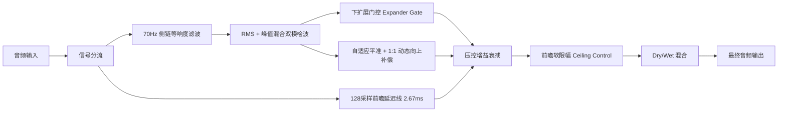

# SanMu Comp — LEV (现代自适应平准) 插件设计说明书
**SanMu Audio Technical Design & Physical Modeling Specification**

---

## 一、模块定位与设计哲学

`VoxEngine`（LEV 自适应平准引擎）是三木音频自主研发的**现代数字前瞻动态平准与贴脸塑造引擎**。

### 核心声学目标
1. **全乐器与人声普适性**：不仅用于现代流行人声（Pop/Rap/R&B），在木吉他扫弦、贝斯平稳控制、电吉他 Solo、钢琴及播客对白（Voiceover）中同样能提供极简、稳健的动态贴脸感；
2. **极简双推子控制**：
   - **COMP**：向下推入即刻增加前瞻平准深度，并自动提供 1:1 动态向上响度补偿（Auto-Makeup）；
   - **GATE**：平滑下扩展门，在消除背景底噪与杂音的同时，完整保留自然呼吸气声与泛音细节；
3. **轻量级前瞻与零失真砖墙保护**：采用黄金性价比的 **128 采样点前瞻延迟线（约 2.67ms @ 48kHz）**，兼顾极速前瞻建压与录音监听轻量化体验，输出电平受 GAIN 天花板严格保护。

---

## 二、架构拓扑与信号处理流

---

## 三、核心算法与数学建模

### 1. 128 采样点前瞻预建压与自适应平滑（Lookahead Pre-Attack Ramping）
- **前瞻延迟**：128 采样点（2.67ms @ 48kHz）；
- **前瞻瞬态速率与波峰因数计算**：
  算法提前 2.67ms 侦测未来音频特征：
  - **短辅音/齿音瞬态**：Attack 自动收紧至 $2.5\text{ms}$，在前瞻窗口内提前无痕完成降压；
  - **长歌声长元音**：Attack 自动放宽至 $10.5\text{ms}$，保护胸腔共鸣；
  - **长音持音（Sustain）**：Release 权重在 35ms 快释与 750ms 慢释间动态平滑 Morphing。

### 2. 侧链等响度加权滤波（Equal-Loudness Filter）
采用 70Hz 一阶高通缓降加权，防止大底鼓或低频喷音导致人声与乐器发生不自然的压暗与抽吸：
$$y[n] = a \cdot (y[n-1] + x[n] - x[n-1]), \quad a = \frac{1}{1 + \frac{2\pi \cdot 70}{f_s}}$$

### 3. 动态平准（COMP）与 1:1 自动向上补偿
- **阈值检测与 S 曲线平滑**：
  $$\Delta L = L_{\text{rms}} - \text{CompThreshold}$$
  采用二阶无纹波平滑包络（快释放 35ms + 慢释放 450~750ms 双阶加权）；
- **1:1 自动向上增益补偿（Auto-Makeup）**：
  $$\text{AutoMakeupGain}(\text{dB}) = -0.95 \times \text{CompKnobDb}$$
  向下拉动 COMP 推子时，弱音被自适应拉起，动态峰值被柔和抚平，轨道瞬间靠前。

### 4. 下扩展门控（GATE）
- **门控阈值**：`-80.0 dB`（完全关闭）$\sim$ `0.0 dB`；
- **自适应软扩展斜率**：
  当输入电平低于 GATE 阈值时，以 1:2 ~ 1:3 的柔顺下扩展斜率平滑衰减，避免硬门截断产生的“切喉感”。

### 5. 前瞻砖墙保护（GAIN 天花板）
- **Ceiling 控制范围**：`-36.0 dB` $\sim$ `0.0 dB`；
- 输出信号严格被限制在用户设定的天花板以下，无论前置推子如何剧烈拉扯，绝对不产生数字削波（True Peak Safe）。

---

## 四、出厂默认参数表 (Defaults)

| 参数项 | 参数 ID | 默认值 | 物理/声学含义 |
| :--- | :--- | :--- | :--- |
| **模式** | `mode` | `ModeClean` / `ModeVOX` (0) | 切换至 LEV 自适应平准引擎 |
| **COMP 平准** | `vox_comp` | `0.0 dB` | 初始无压缩（范围 -36dB ~ 0dB） |
| **GATE 门控** | `vox_gate` | `-80.0 dB` | 默认完全关闭，保留自然泛音与气声 |
| **GAIN 增益** | `vox_gain` | `0.0 dB` | 默认 0dBFS 输出天花板 |
| **MIX 干湿比** | `vox_mix` | `100.0%` | 全湿信号输出 |

---

## 五、版本调校与维护记录日志 (Changelog)

- **v1.1 (2026-09-03)**:
  1. 将前瞻延迟线优化为 **128 采样点（2.67ms @ 48kHz）**，实现顶级声学平准与录音监听超轻延迟的黄金性价比；
  2. 实现全插件动态按模式上报延迟机制（LEV 模式上报 128 采样 PDC，三大模拟模式上报 0 采样零延迟）。
- **v1.0 (2026-09-03)**:
  1. 正式由 `VOX` 升级定名为 `LEV (Adaptive Leveler)`，确立人声与乐器全能平准定位；
  2. 确立 70Hz 侧链加权算法、1:1 动态自适应向上增益补偿与智能防破音保护。
