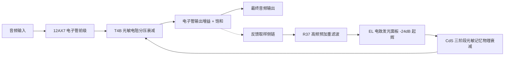

# SanMu Comp — Opto (温润光电管机) 插件设计说明书
**SanMu Audio Technical Design & Physical Modeling Specification**

---

## 一、模块定位与设计哲学

`OptoEngine`（经典温润光电管机引擎）是基于 **T4B 电致发光（EL）光电管 + 12AX7 双三极电子管** 经典声学特性打造的传奇级平准压限引擎。

### 核心声学目标
1. **真实三阶段光物理迟滞（3-Stage Phosphorescence Release）**：精准复刻硫化镉（CdS）光敏物质的荧光快响应与深阱磷光慢记忆特性，极度顺滑平准；
2. **极简经典交互**：
   - **PEAK REDUCTION (0~100)**：顺时针驱动 T4B 发光面板产生平滑光敏压缩；
   - **GAIN (0~100)**：40.0 为标准 Unity 0dB 工作点，调节电子管输出放大；
   - **COMP / LIMIT 切换**：COMP 为柔顺平准（约 3:1~4:1），LIMIT 为强力峰值限制（约 10:1+）；
3. **温暖谐波染色**：模拟 12AX7 电子管推挽放大的温和偶次与奇次谐波饱和（THD 0.1% ~ 0.3%）。

---

## 二、架构拓扑与信号处理流



---

## 三、T4B 真实三阶段光物理与记忆释放建模

### 1. 物理三阶段释放权重分配
T4B 光敏元件的释放并非简单的单一时间常数，而是由物理材料特性涌现的三段叠加：
- **第一阶段（60% 权重，`optoGrFastDb`）**：
  $\tau_{\text{fast}} = 0.50\text{s}$，1~3 秒内快速恢复前 60% 动态，保留声音自然活力；
- **第二阶段（30% 权重，`optoGrMidDb`）**：
  $\tau_{\text{mid}} = 1.20\text{s}$，3~5 秒内平缓恢复接下来的 30%（累计完成 90%）；
- **第三阶段（10% 权重，`optoGrSlowDb`）**：
  $\tau_{\text{slow}} = 2.20\text{s}$，带 10~15 秒深阱超慢长尾归零。

### 2. 历史光敏记忆效应（Historical Optical Memory）
```cpp
const float grIntensity = juce::jlimit(0.0f, 1.0f, (fastDb + midDb + slowDb) / 20.0f);
if (targetDb > 0.5f)
{
    const float chargeRate = 0.15f + 0.85f * grIntensity;
    mem = std::min(mem + dt * chargeRate, 1.0f); // 持续强光累积记忆电荷
}
else
{
    const float dischargeRate = 0.05f / (1.0f + 1.5f * mem);
    mem = std::max(mem - dt * dischargeRate, 0.0f); // 记忆电荷缓慢释放
}
```
- **浅压（GR $\le$ 3dB）**：85%~90% 快分量释放，极速干净自然；
- **持续重压（GR $\ge$ 15dB）**：中慢深阱分量占比提升至 50%~55%，呈现经典的长达 10~15 秒的物理迟滞长尾！

### 3. COMPRESS vs LIMIT 模式切换
- **COMPRESS 模式**：分压定臂 $R_{\text{fixed}} = 70.7\text{ k}\Omega$，呈现约 3:1 ~ 4:1 的大弧度软拐点，最适合流行人声与电贝斯平滑整平；
- **LIMIT 模式**：分压定臂 $R_{\text{fixed}} = 68.0\text{ k}\Omega$，呈现约 10:1+ 的强力峰值限制。

---

## 四、出厂默认参数表 (Defaults)

| 参数项 | 参数 ID | 默认值 | 物理/声学含义 |
| :--- | :--- | :--- | :--- |
| **模式** | `mode` | `ModeOpto` (3) | 切换至 Opto 光电管机引擎 |
| **Peak Reduction**| `opto_peak_reduction` | `50.0` | 0~100 刻度，默认产生 3~5dB 黄金平滑平准 |
| **Gain 电子管增益**| `makeup` / `opto_gain` | `40.0` | 0~100 刻度，40.0 为标准 Unity 0dB 工作点 |
| **模式切换** | `opto_is_limit` | `false` | false = COMP (平准), true = LIMIT (限幅) |
| **Mix 干湿比** | `mix` | `100.0%` | 全湿信号输出 |
| **Link 立体声** | `stereo_link` | `100.0%` | 左右声道联动 |

---

## 五、版本调校与维护记录日志 (Changelog)

- **v1.0 (2026-09-03)**:
  1. 彻底去商标化，规范命名为 `Opto (Vintage Optical Tube Leveler)`；
  2. 确立 T4B 真实三阶段光物理与 CdS 历史记忆效应模型；
  3. 完善 12AX7 电子管非线性谐波饱和与 Unity 40 刻度标定。
