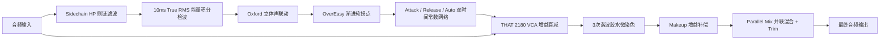

# SanMu Comp — VCA (模拟总线胶水) 插件设计说明书
**SanMu Audio Technical Design & Physical Modeling Specification**

---

## 一、模块定位与设计哲学

`VcaEngine`（模拟 VCA 总线胶水引擎）是针对**全曲母带总线（Master Bus）、鼓组总线（Drum Bus）与乐器群组（Mix Groups）**打造的经典模拟压限引擎。

### 核心声学目标
1. **立体声粘合感（Glue）**：通过对数真有效值（True RMS）检波与软拐点，将分散的乐器织体紧紧聚合为整体；
2. **Auto 智能双阶段释放**：忠实复刻经典 82E27 双时间常数放电网络，瞬态迅速恢复，长音平缓衰减，彻底杜绝总线抽吸；
3. **THAT 2180 VCA 微染色**：引入 3 次奇次谐波模拟温润感，增强混音的密度与厚度。

---

## 二、架构拓扑与信号处理流

---

## 三、核心算法与硬件级物理建模

### 1. 对数真有效值检波（Logarithmic True RMS Detection）
采用 10ms 物理能量积分时间窗口：
$$P_{\text{rms}}[n] = P_{\text{rms}}[n-1] + \alpha_{\text{rms}} \cdot (x^2[n] - P_{\text{rms}}[n-1]), \quad \alpha_{\text{rms}} = 1 - e^{-\frac{1}{0.010 \cdot f_s}}$$
$$\text{Level}_{\text{dB}} = 20 \log_{10}(\sqrt{P_{\text{rms}}})$$

### 2. OverEasy 渐进软拐点算法
- 经典 4dB 渐进软拐点过渡，在超标前后平滑过渡，保证母带压限无痕迹：
  $$\text{GR}(\text{dB}) = \begin{cases}
  0, & \Delta L \le -2.0 \\
  \left(1 - \frac{1}{R}\right) \cdot \dfrac{(\Delta L + 2.0)^2}{8.0}, & -2.0 < \Delta L < 2.0 \\
  \left(1 - \frac{1}{R}\right) \cdot \Delta L, & \Delta L \ge 2.0
  \end{cases}$$

### 3. 经典三档比率与阈值联动补偿
- **2:1**：温和母带总线胶水（附带 +0.75dB 软起压微调，最适合全曲 Mix Bus）；
- **4:1**：标准混音冲击总线（鼓组与紧凑摇滚）；
- **10:1**：紧凑总线压限（强力控制大动态峰值）。

### 4. Auto 双时间常数自适应释放电路（SSL 82E27 物理复刻）
当 Release 设为 `Auto`（$\ge 1200\text{ms}$）时：
- **快放电通路**（0.47μF 快电容）：$\tau_{\text{fast}} = 80\text{ms}$，负责捕捉并快速释放突发单次击打；
- **慢放电通路**（6.8μF 慢电容）：充电速度慢 14.5 倍（$\tau_{\text{att\_slow}} = 14.5 \times \tau_{\text{att}}$），仅在持续长音时被充满，释放时间为 $\tau_{\text{slow}} = 1.20\text{s}$；
- **声学表现**：底鼓军鼓瞬态打完立刻弹回，长贝斯与弦乐平稳延展，声场宽广且绝无抽吸！

---

## 四、出厂默认参数表 (Defaults)

| 参数项 | 参数 ID | 默认值 | 物理/声学含义 |
| :--- | :--- | :--- | :--- |
| **模式** | `mode` | `ModeVCA` (1) | 切换至 VCA 模拟总线引擎 |
| **Threshold 阈值**| `threshold` | `-18.0 dB` | 设定总线压缩门限（-60dB ~ 0dB） |
| **Ratio 比率** | `ratio` | `4.0` (4:1) | 2:1 / 4:1 / 10:1 经典三档 |
| **Attack 启动** | `attack` | `10.0 ms` | 0.1 / 0.3 / 1 / 3 / 10 / 30 ms 步进 |
| **Release 释放** | `release` | `150.0 ms` | 0.1 / 0.3 / 0.6 / 1.2s 与 Auto (2000ms) |
| **Makeup 补偿** | `makeup` | `0.0 dB` | -24dB ~ +24dB 纯净线性补偿 |
| **SC HP 侧链** | `sidechain_hp` | `60.0 Hz` | 侧链高通滤波，防止低频能量过载 |
| **Mix 干湿比** | `mix` | `100.0%` | 经典纽约并联压缩混合比例 |

---

## 五、版本调校与维护记录日志 (Changelog)

- **v1.0 (2026-09-03)**:
  1. 彻底去商标化，规范命名为 `VCA (Analog Bus Glue)`；
  2. 实现 82E27 真实的 Auto 双时间常数双电容放电物理模型；
  3. 优化 OverEasy 4dB 渐进软拐点与立体声 Oxford 联动检波。
