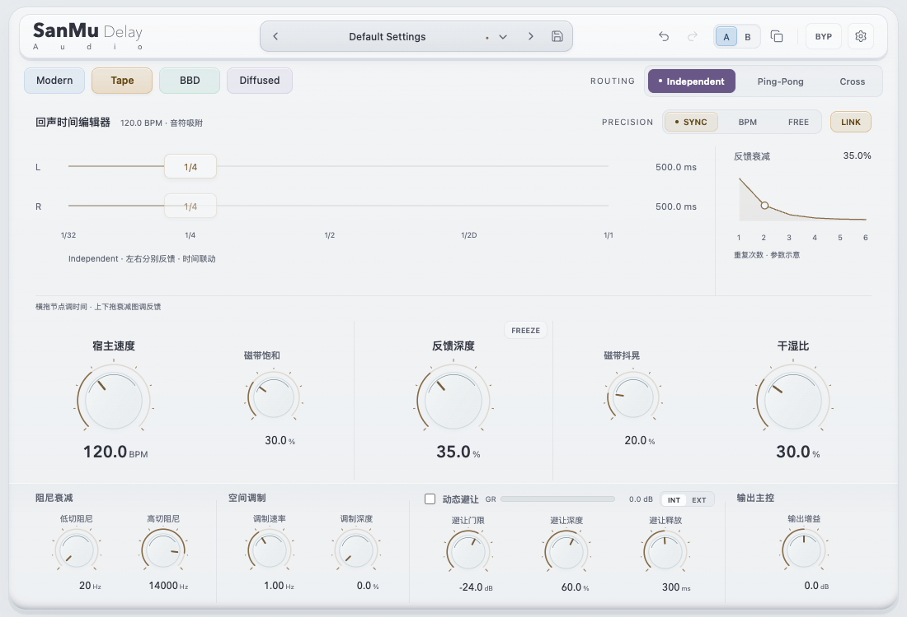
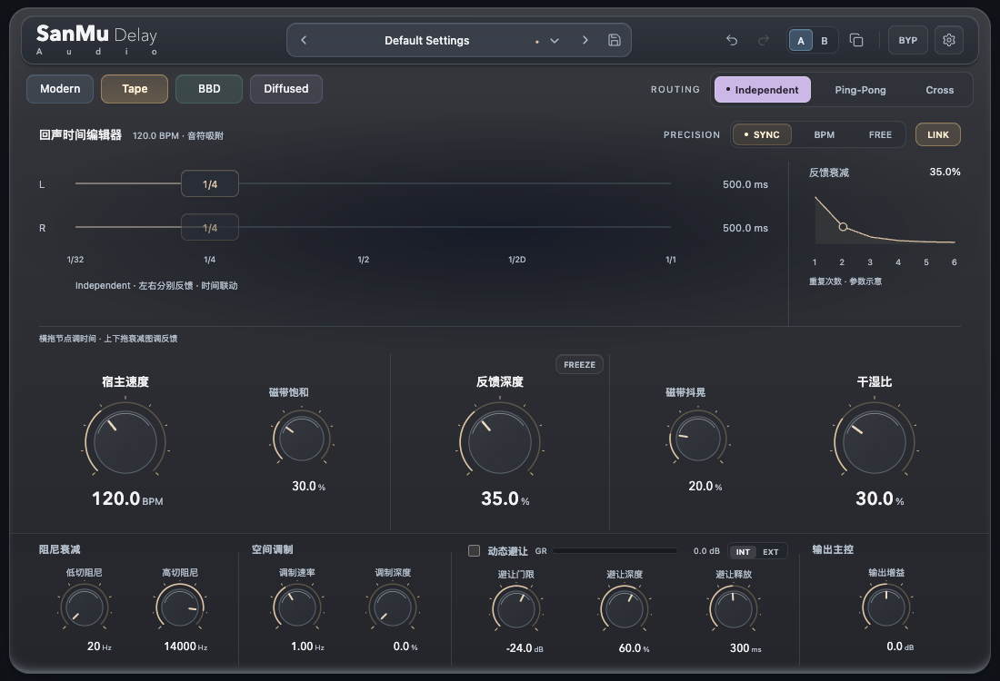

# 控件可见性与 Duck GR 修正

本记录替代《Delay 全面升级与布局决策》中关于 PRECISION 提示、隐藏旧卡片、底部电平条的阶段性描述。

## 已确认的问题

- 引擎组继承整行宽度，将右侧路由挤出窗口；旧选中底色还把 RGB 分量误当完整颜色使用。
- Duck GR 放在三枚 Ducking 旋钮下方，被固定面板高度裁切；编辑器底部还残留 WET／DUCK 读数，出现在 Mix 上方。
- 上轮把 PRECISION 的时钟选择误删成纯说明文字，使 SYNC／BPM／FREE 没有可见入口。隐藏的旧卡片并不承担桥接兼容作用，现已移除其初始化及 DOM。

## 当前实现

- 四种引擎在左，Independent／Ping-Pong／Cross 在同排右侧；浅色用深紫底白字，深色用浅紫底深字。
- PRECISION 位于路由下方，保留 SYNC／BPM／FREE 与 LINK。取消那条纯英文说明和重复的时间卡。
- 时间节点支持拖动、方向键、双击或回车输入；同步模式输入音符，FREE 输入毫秒或秒。
- BPM 旋钮在左、Feedback 在中央、Mix 在右；音色旋钮在 Feedback 两侧按引擎出现。SYNC 显示宿主速度且不写入手动 BPM，BPM 可编辑，FREE 下置灰。
- 主电平表及编辑器底部 WET／DUCK 全部移除。Duck GR 位于 Ducking 标题内，使用真实的宿主 `duckGr`；条形范围 0～24 dB，数字保留实际读数。网页没有音频时显示 0.0 dB 和空轨道。
- 缩减主控制区高度，确保底部模块完整落在面板内。

## 本轮验证

- 浏览器真实点击、旋钮数值、节点拖动与输入、LINK、Freeze、预设及帮助通过；新增 288 组可见性检查（两种窗口宽度 × 两主题 × 两语言 × 四引擎 × 三路由 × 三时钟），另检查五档缩放及 506 像素外层 iframe。
- 原生 WebKit 检查路由、时钟按钮及 Ducking 小表均在面板内；测试音频触发真实 Ducking 后，原生传输到网页的 GR 数字大于 6 dB、条形长度同步增加。
- 完整 CTest 2/2 通过；AU／VST3／AAX 构建成功。本轮未替换已安装插件，也未进行 DAW 听测。
- 预览使用 `http://localhost:50586/preview.html?review=20260913-visible-fix`。恢复了中断后无响应的本地服务。

## 复现

```sh
PLAYWRIGHT_MODULE=/Users/zhaojin/.cache/codex-runtimes/codex-primary-runtime/dependencies/node/node_modules/playwright/index.mjs node tests/test_delay_web.mjs
cmake --build build-test -j2
ctest --test-dir build-test --output-on-failure
```

浅色与深色截图：




