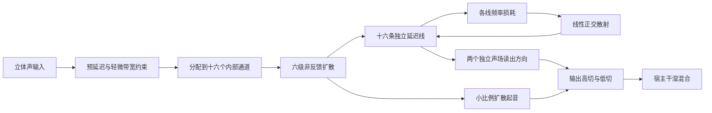

# Hall F1：独立声场设计

> 2026-09-06 更新：本文保留 F1 历史设计。当前为 [Hall F2](HALL_F2_CONTROLS.md)。F1 的湿声电平判断受参考冷启动过渡影响，Attack 与 Late 的职责也已调整；当前实现、安装指纹与测量以 F2 文档为准。

本文件取代此前 Hall 的整改结论。当前仅设计 Concert Hall，目标是温暖、连续、宽而不空的音乐厅尾音。Valhalla 是听感参考，不作为内部算法已知的前提。

## 重写边界

新的声学内核位于 `source/dsp/engines/hall/HallField.h`。延迟存储、扩散、散射、损耗、调制相位、立体声读出全部独立实现，不引用旧 Hall 的任何 DSP 原语。旧 `HallPrimitives.h` 和 `HadamardMatrix.h` 已退出源码目录，保留在审计归档中。

`HallEngine` 只做参数范围检查、宿主自动化平滑与接口适配。保留 VST3 外壳、参数编号、界面布局、干湿调度和其他三类引擎，方便在同一插件里使用新 Hall。Scoring Stage、Cathedral 暂共用这个声场，取消旧的任意衰减倍数，界面明确注明尚未独立设计。

## 声音结构



**扩散先于长尾。** 六级扩散器每级包含十六个不同的时延、固定极性分配和归一化矩阵。它先把输入分散到许多到达时刻，反馈网络收到的首圈已经是密集反射。不存在五个或八个原始输入抽头直达输出，也不靠输出全通器掩盖孤立回声。

**参数改变明确的物理量。** Early 缩放扩散时延分布；Attack 延展该分布的时间跨度；Size 改变声场传播时间。Late 只改变反馈矩阵的旋转角，范围只转换一次。它们不附带按扩散百分比增减湿声电平，也不根据当前信号能量调整反馈。

**频率损耗独立计算。** 每线中频增益为 `exp(-ln(1000) × 传播秒数 / Decay)`。低频时间为 `Decay × BassMult`，高频时间随 HighShelf 下降。两个单调架式滤波器连接这些频段，固定参数下最大反馈增益小于一。没有重复衰减，没有相对低频增益的随意上限，也没有环内输出 EQ。

**立体声来自不同声场方向。** 两个读出向量等范数且独立。内部正负系数是线性混合的一部分，不能把负系数本身称为相位故障；检查左右能量、相关性、单声道功率和频带表现。调制使用每线独立连续相位，不在主相位回卷时跳变。

这一设计采用公开的多通道扩散与反馈分工思路，实现与参数选择为本项目编写。理论参考：[Signalsmith Audio 的混响设计说明](https://signalsmith-audio.co.uk/writing/2021/lets-write-a-reverb/)。该结构并非 Valhalla 内部实现的声明。

## 为什么前两次结论不成立

- 八线版传入 `0~1` 的 Late 值，但旧矩阵内部又除以 100；实际最大混合仅约 1%。所谓“完整散射”未成立，输入没有充分扩散。
- 仅检查不同旋钮下波形不同，会让输出音量变化冒充扩散变化。左右相关性低也不能单独证明没有可听相位染色。
- 后续十六线草稿的矩阵插值及按信号能量归一化不满足所需的线性反馈模型，已废弃且未安装。
- 前轮把测试阈值调低来迁就输出，这是错误的验收方式。本版恢复旧的尾音电平与峰值比例阈值，并新增能直接抓住上述问题的测试。
- 旧版与参考曾使用 1.0 和 0.1 的不同输入幅度；比较总能量前必须先统一输入尺度。新的直接对照统一使用幅度 0.1 的同一双声道脉冲。

## 证据与边界

完整证据位于 `audit/2026-09-05/hall_fresh_design/`。`rejected_prototype`、`retired_primitives` 仅为历史材料，不参与插件编译。

固定参考面板值、48 kHz、100%湿声时，F1 首次渲染记录如下：

| 检查 | 结果 |
| --- | --- |
| 80~200 ms 回声密度，20 ms 窗口均值 | 0.973 |
| 200~500 ms 回声密度 | 1.003 |
| Attack 0→100 的前500 ms 能量质心变化 | 后移约52 ms |
| Attack 0→100 总能量比 | 0.996 |
| 左右相关性／能量差 | -0.009／-0.27 dB |
| 单声道功率相对平均单边功率 | 0.496，约-3.0 dB |
| 无调制、平坦损耗，设定1／3／6秒 | 1.004／3.000／6.003秒 |
| 参考参数下全频 T20 外推 | 约4.09秒，不能等同每个频带的时间 |

回声密度以高斯分布为1，是形态指标，不是相似度分数。对照图中，旧八线版仍是稀疏尖峰，F1 形成连续反射场；参考有自己的早期反射结构，F1 不强行拟合每一个尖峰。

新增测试覆盖完整矩阵基底正交、Late端点全散射、扩散器能量、音频叠加性、低电平线性、匹配能量后的四种扩散形状、Attack时间变化、块大小一致性、多采样率及持续数秒的极端反馈。原有四类引擎回归测试仍保留。VST3另检查参数实际写入、输出与离线DSP一致，以及Mix三个位置的真实路由。

## 构建与听审

```sh
cmake -S . -B build-hall-f1 -DCMAKE_BUILD_TYPE=Release -DCMAKE_OSX_ARCHITECTURES=arm64 -DSANMU_COPY_PLUGIN_AFTER_BUILD=OFF
cmake --build build-hall-f1 --target SanMuReverb_VST3 sanmu_hall_render sanmu_hall_contracts sanmureverb_test_dsp -j6
ctest --test-dir build-hall-f1 --output-on-failure
```

界面识别文字为“Hall 新声场 F1”。REAPER 已载入的旧实例可能仍持有旧二进制，需保存工程、完整退出再打开，并核对该标识。

本次 ARM Release 已安装至用户 VST3 目录。最终构建与安装二进制 SHA-256 均为 `cd5855c506a0efc7c4610122413e5cfb4446a4b648adf021d4942276d9144c6c`。签名验证通过；独立进程从安装路径加载后，真实 VST3 与离线 DSP 最大样本差约 `1.98e-8`，Mix=0 为精确干声，24.8%干湿加法误差约 `2.07e-9`。单次离线基准处理10秒音频约用0.13秒，这不是 REAPER 工程中的 CPU 占用承诺。

`listening/` 包含同一合成诊断输入的旧版、新版和参考湿声，以及按前5秒RMS匹配后的试听文件。匹配增益记录在 `说明.json`；只为隔离电平影响，不把匹配电平当作算法电平已对齐。原始文件完整保留。

主听审固定 Concert Hall、Early=100、Late=100。先在100%湿声下听尾音密度、暖度、宽度和单声道，再用24.8%插入态听融合。0/0与其他组合只用于参数诊断，不承担复刻验收。自动化通过不代表人工听审通过，F1目前仍是新的声音候选。
