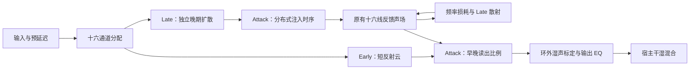

# Hall F2：湿声电平、Attack 与 Late 核查

2026-09-06。用户认可 F1 的整体改善，本轮针对三个明确问题调整。F2 已构建并安装，自动检查通过。随后用户听审认为已非常接近参考，将当前版本确认为 **0906A 初稿**；详细反馈、保留疑点和冻结信息见 [0906A 初稿冻结记录](0906A_初稿冻结记录.md)。

## 根因与修改

**湿声过小确实存在，之前的校准依据有误。** 在完全相同的输入与参数下，VintageVerb 第零采样收到脉冲时的输出能量，比前置一秒静音后低约 11.18 dB。前置一秒和三秒的差异仅约 0.01 dB，说明必须避开实测启动过渡。此前的冷启动脉冲能量相近，不能证明插件正常工作时电平相近。F1 在脉冲、短噪声、持续噪声和和弦上实际低约 10.8～14.5 dB。

F2 的输出标定系数从 0.42 调到 1.72，早晚声的读出结构也重新分配了能量。标定系数只在反馈环外，不随输入幅度变化，不修改环内反馈增益，不加入限幅或动态归一化。用多种输入校准，原始湿声与单独匹配响度的试听文件分别保存。

**F1 的 Attack 职责过窄。** 它只拉伸输入扩散时延，并与 Early 相乘；Early=0 时失效。F2 的 Attack 控制早期反射的存在感，以及十六个晚期注入通道的到达时间分布。增大 Attack，早期声减弱，晚期声更缓慢地建立；适量将能量转向晚期，避免变成单纯的音量旋钮。

晚期注入延迟只经过一次，不加入反馈周期；衰减时间仍由原有环路长度和频率损耗决定。这不是输入触发的压缩器包络，也没有每次重置才生效的输出淡入。

Attack 不是某个通用标准电路的名称。厂商也会用不同名称表示建立时间或早晚反射关系，例如 [ValhallaFutureVerb 的官方控制说明](https://valhalladsp.com/?p=843271)。这只能解释参数语义；不能据此断言 VintageVerb Concert Hall 的内部结构。本文对后者的比较来自本机插件输出的测量，F2 是独立实现。

**F1 的 Late 被已经密集的输入掩盖。** Early=100 时，完整六级输入扩散先生成了密集声云；改变尾音网络的反馈混合，仍会循环这团密集声云。因此检查“波形是否不同”不足以证明 Late 可用。

F2 分为两个并行支路：Early 控制较短的六级反射云；Late 同时控制独立晚期扩散器的路径混合和反馈散射。混合使用正交旋转（保持多通道能量的线性混合），满值保留六级充分扩散。考虑到级联路径增长很快，Late 使用 2.5 次幂曲线展开中段的调节范围。

最终波形审查还排除了一个中间候选：其早期支路只有两级，过于集中，早晚衔接出现深谷。最终采用较短的六级早期反射云，并增加默认参数下衔接能量的回归检查。中间候选未安装。

## 固定输入结果

参考为本机 VintageVerb 4.0.5，Concert Hall、1970s，使用用户确认的完整参数，算法比较设为 100% 湿声。采样率 48 kHz，块长 128，每次新实例，主测量输入前有一秒静音。输出未归一化、未做峰值对齐。

| 输入 | F1 相对 VintageVerb | F2 相对 VintageVerb |
| --- | ---: | ---: |
| 脉冲 | -10.92 dB | +2.15 dB |
| 30 ms 短噪声 | -10.83 dB | +2.25 dB |
| 三秒持续噪声 | -10.84 dB | +2.05 dB |
| 一秒三音和弦 | -14.53 dB | -1.56 dB |

另一个合成敲击与短和弦试听序列中，前五秒原始湿声 RMS（均方根电平）为 F1=0.00537、F2=0.02367、参考=0.02317，F2 比参考高约 0.18 dB。这是指定素材的结果，不保证任意音乐都完全等响。

Supernova Verb 只作为第二个电平尺度参考：Vintage Hall、4.00 秒、20 ms、100% 湿声，其余为实例默认值，完整参数回读在审计文件中。其参数系统不同，不能宣称与 VintageVerb 完全同参。上述四种输入中 F2 相对它的差异为 -1.73～+2.13 dB。

| Attack | F1 能量中位时刻 | F2 能量中位时刻 | VintageVerb 能量中位时刻 |
| --- | ---: | ---: | ---: |
| 0% | 211 ms | 108 ms | 62 ms |
| 50% | 225 ms | 213 ms | 146 ms |
| 100% | 273 ms | 346 ms | 325 ms |

能量中位时刻是“累计收到一半湿声能量的时间”，用于检查前后分布，不能直接等同于感知距离。F2 的变化方向与跨度已明确，具体曲线与参考仍有差异。

| Late，Early 固定100% | F1 晚期密度 | F2 晚期密度 | VintageVerb 晚期密度 |
| --- | ---: | ---: | ---: |
| 0% | 1.020 | 0.100 | 0.449 |
| 50% | 1.017 | 0.635 | 0.653 |
| 100% | 1.001 | 0.992 | 0.866 |

密度使用 200～500 ms 内的 20 ms 窗口均值，高斯噪声参考为1。它不是相似度百分比。F2 的低端有意保留明显稀疏输出，低端比参考更稀疏；100%仍为密集尾音，不能因为两者数字不同就认定听感优劣。

## 验证、安装与复听

原有两个测试组全部通过，未降低原阈值。新增检查覆盖：晚期扩散各档的多通道能量、Early=100 时 Late 的端点和中段密度、Attack 的中位时刻与早晚能量关系、Early 各档下 Attack 有效、默认高扩散的早晚反射衔接。保留线性叠加、块长一致性、44.1/96/192 kHz、立体声与单声道兼容、长衰减极端反馈等检查。

最终独立 DSP 检查：80～200 ms 密度0.937、200～500 ms密度0.996；左右相关0.019、左右能量差0.10 dB、单声道功率比0.509。平坦损耗下设定1/3/6秒，测得约1.004/2.990/6.012秒。

ARM Release 已安装至用户 VST3 目录。构建和安装二进制 SHA-256 相同：

`780055e9e3028d75d97336ed22976d3fe4acb3a0ba8203827002862c7e406236`

签名验证通过。独立宿主从安装路径重新加载，VST3 与同参数离线 DSP 最大差约9.05e-8；Mix=0 为精确干声，24.8%的本插件干湿加法误差约2.07e-9。一次10秒离线处理耗时约0.285秒，不代表 REAPER 工程中的实际 CPU 占用。

先保存工程、完整退出并重新打开 REAPER，核对界面“Hall 新声场 F2”。保持其余参考参数不变：先在 Mix=100、Early=100、Late=100 下对比原始湿声电平；再分别单独切换 Attack 0/50/100、Late 0/50/100。最后回到24.8%的插入态判断融合与远近。只有音色比较使用另存的匹配电平文件，电平判断必须使用原始文件。

证据目录：`audit/2026-09-05/hall_controls_f2/`。日期沿用本轮开始日期。`baseline/` 是真正的 F1 源码和已安装插件备份；`final/`、`final_dsp/`、`installed/` 是本次最终输出；`summary/参数核查.png` 是对照图；`listening/` 包含原始和匹配电平试听。`trial*` 是未安装的中间候选，不能作为交付版本。

关键复现工具：`tools/measure_hall_controls.py`、`tools/report_hall_controls.py`、`tools/check_hall_vst3.py`。`tools/render_reference.py` 与试听工具已加入一秒静音预热。核心改动的 F1→F2 差异另存为 `F1_to_F2.patch`。
